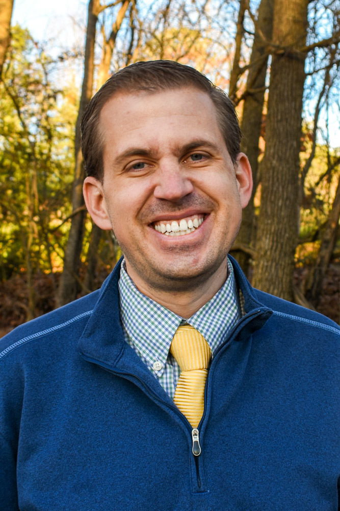
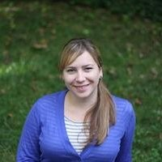

Join us at **R+AI 2026**, the R Consortium conference dedicated to the open-source R community and every facet of artificial intelligence.

This year, R+AI is being held November 10-11, 2026.

Lend your voice to the community! We want to hear about your experience and specific workflows—from machine learning and large language models in R, to AI-assisted coding tools, industry deployments, and responsible AI research.

[Register now!](https://events.zoom.us/ev/AvKPIaFGx9jwfTQyiDQcLmRWjmoDg4b4O20UQLssgTvlWDoXuMh5~AvDbrQHgBmJBUNpTBSMDUTQVfVen6k7w_xlMXZremUKDubDA3Q9AQ7-FRQ){.btn .btn-rai-mustard .btn-rai-lg role="button"}

## KEYNOTE ADDRESSES

### Andrew Heiss, Ph.D., Assistant Professor of International Politics and Policy, Georgetown University in Qatar

#### Opening Keynote

Date & Time: November 10 at 8:00 AM, Eastern

{style="border-radius: 50%; width: 300px; height: 300px; object-fit: cover; object-position: center 15%;"}

#### Bio

Andrew Heiss's research examines how international NGOs work in authoritarian countries. He received the 2016–2018 Emerging Scholar Dissertation Award from the International Society for Third Sector Research (ISTR). He also works in public administration and policy, nonprofit management, international relations, and comparative politics.

He teaches quantitative research methods and data science, program evaluation and causal inference, data visualization, economics, and science communication. He is a certified RStudio instructor and a Posit Academy mentor.

### Mine Çetinkaya-Rundel, Professor of the Practice at Duke University & Developer Educator at Posit, PBC

#### Closing Keynote

Date & Time: November 11 at 3:15 PM, Eastern

{style="border-radius: 50%; width: 300px; height: 300px; object-fit: cover;"}

#### Bio

Mine Çetinkaya-Rundel is Professor of the Practice of Statistical Science and the Director of Undergraduate Studies in the Department of Statistical Science, as well as an affiliated faculty member in the Computational Media, Arts, and Cultures program at Duke University. Her work is dedicated to advancing innovation in statistics and data science pedagogy, focusing particularly on computing, reproducible research, student-centered learning, and open-source education. She emphasizes integrating computation into the undergraduate statistics curriculum, employing reproducible research methodologies, and analyzing real and complex datasets.

[LinkedIn](https://www.linkedin.com/in/minec/) · [Mastodon](https://fosstodon.org/@minecr) · [Bluesky](https://bsky.app/profile/minecr.bsky.social)

## R + AI Community Needs Survey

Where is the R community on AI today, and where is it headed? Take this short survey on tools, trust, reproducibility, and real-world workflows. Your responses will help shape R Consortium webinars, working groups, resources, and R+AI 2026 programming.

It takes about 7–10 minutes, and respondents who share an email get early access to the results.

[Learn more and take the survey](survey.qmd){.btn .btn-rai-mustard role="button"}

## Sponsorships

If you would like to know about sponsorship opportunities, please write to sponsorship@r-consortium.org.
