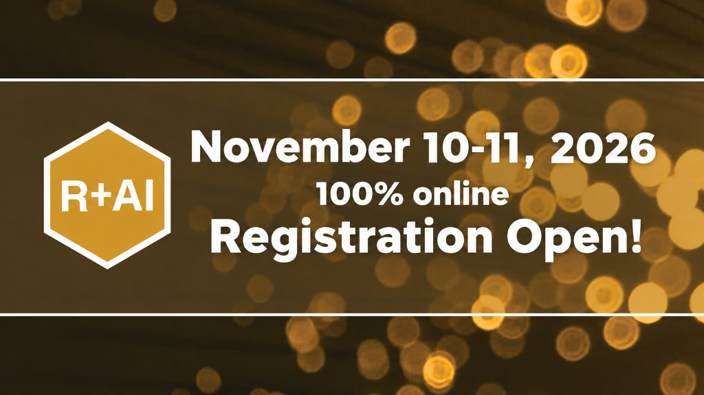
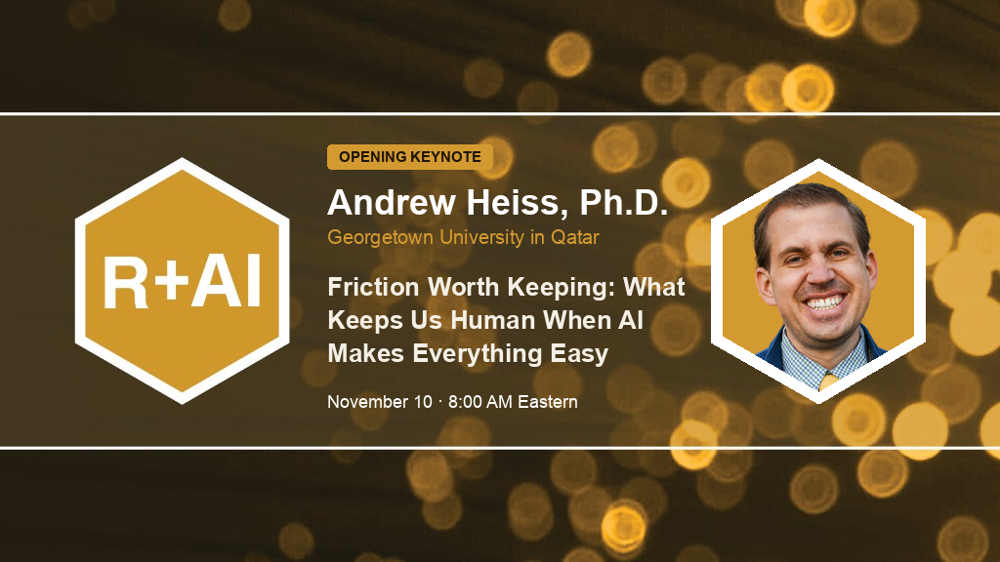
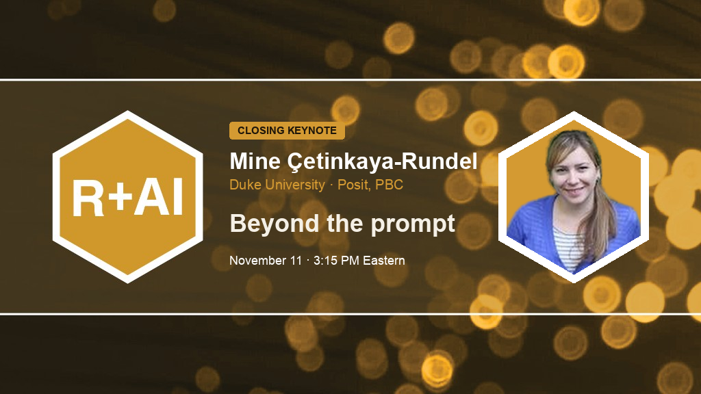

Join us at **R+AI 2026**, the R Consortium conference dedicated to the open-source R community and every facet of artificial intelligence.

This year, R+AI is being held November 10-11, 2026.

Lend your voice to the community! We want to hear about your experience and specific workflows—from machine learning and large language models in R, to AI-assisted coding tools, industry deployments, and responsible AI research.

[Register now!](https://events.zoom.us/ev/AvKPIaFGx9jwfTQyiDQcLmRWjmoDg4b4O20UQLssgTvlWDoXuMh5~AvDbrQHgBmJBUNpTBSMDUTQVfVen6k7w_xlMXZremUKDubDA3Q9AQ7-FRQ){.btn .btn-rai-mustard .btn-rai-lg role="button"}

## KEYNOTE ADDRESSES

[{fig-alt="R+AI 2026 Opening Keynote card: Andrew Heiss, Ph.D., Georgetown University in Qatar. Friction Worth Keeping: What Keeps Us Human When AI Makes Everything Easy. November 10, 8:00 AM Eastern."}](Abstracts.qmd#andrew-heiss)

### Friction Worth Keeping: What Keeps Us Human When AI Makes Everything Easy

**Andrew Heiss, Ph.D.**, Assistant Professor of International Politics and Policy, Georgetown University in Qatar

**Opening Keynote** · November 10 at 8:00 AM, Eastern

Generative AI removes friction. Need a poster for an event? Slides for stakeholders? An R package to access an API? An answer for a problem set? It's all a prompt away. But not all friction is bad. Some friction is formative and central to the human experience: struggling to learn develops skills and expertise, and working through hard problems builds understanding and judgment. How can we tell what friction is worth keeping?

[Read the full abstract and bio](Abstracts.qmd#andrew-heiss)

[{fig-alt="R+AI 2026 Closing Keynote card: Mine Çetinkaya-Rundel, Duke University. Beyond the prompt. November 11, 3:15 PM Eastern."}](Abstracts.qmd#mine-cetinkaya-rundel)

### Beyond the prompt

**Mine Çetinkaya-Rundel**, Professor of the Practice, Department of Statistical Science, Duke University; Senior Developer Advocate, Posit, PBC

**Closing Keynote** · November 11 at 3:15 PM, Eastern

AI tools can generate a polished ggplot, scaffold a Quarto report, and debug a dplyr pipeline in seconds. Should students still learn to do these things themselves? I argue yes, and that teaching programming and reproducible workflows is more important than ever. This talk reframes programming as a pathway to statistical thinking rather than syntax acquisition, and explores assignments and assessments that prepare students to use AI critically, reproducibly, and responsibly.

[Read the full abstract and bio](Abstracts.qmd#mine-cetinkaya-rundel)

[Register now to hear both keynotes!](https://events.zoom.us/ev/AvKPIaFGx9jwfTQyiDQcLmRWjmoDg4b4O20UQLssgTvlWDoXuMh5~AvDbrQHgBmJBUNpTBSMDUTQVfVen6k7w_xlMXZremUKDubDA3Q9AQ7-FRQ){.btn .btn-rai-mustard .btn-rai-lg role="button"}

## R + AI Community Needs Survey

Where is the R community on AI today, and where is it headed? In September and October 2026, R Consortium conducted a short survey on tools, trust, reproducibility, and real-world workflows. The responses are helping shape R Consortium webinars, working groups, resources, and R+AI 2026 programming.

Respondents who shared an email are getting early access to the results. The full report will be available online on the R Consortium website following R+AI 2026.

[Learn More](survey.qmd){.btn .btn-rai-mustard role="button"}

## Sponsorships

If you would like to know about sponsorship opportunities, please write to sponsorship@r-consortium.org.
